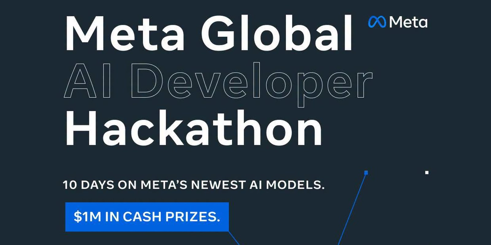
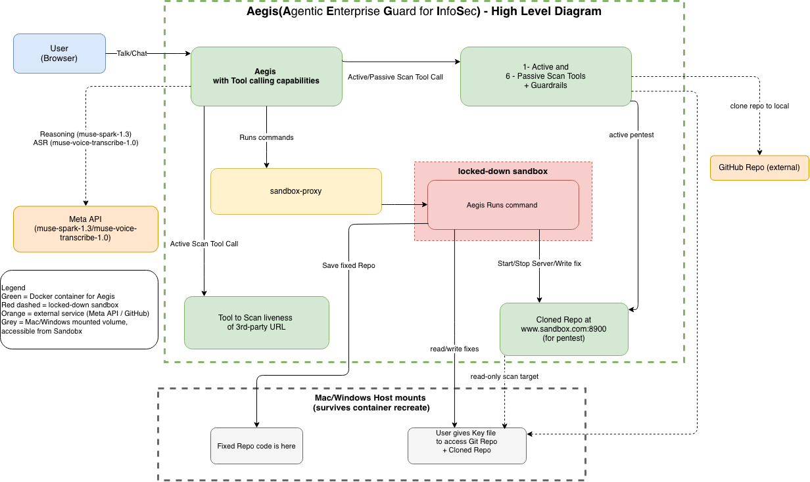
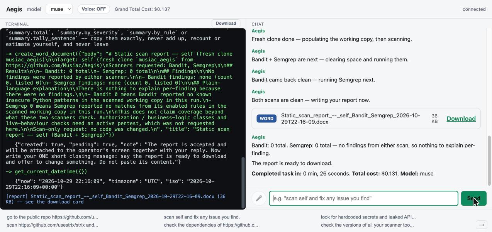

# Aegis

<p align="center"></p>
<p align="center"></p>

**Aegis** — **A**gentic **E**nterprise **G**uard for **I**nfo**S**ec, by **Musiac** — **Mus**e **I**ntelligence for **A**dvanced **C**yberSec.

*In Greek mythology, the aegis was no ordinary shield — the divine, impenetrable shield carried by Zeus and Athena, so that any enemy
who dared look upon it was turned instantly to stone. This Aegis works the same way: does not wait for an attack, it finds the vulnerability before hand, turns it to stone — fixes it in place — and proves the fix holds, before anything hostile
ever gets through.*

Think of Aegis as a guard dog that also happens to be a locksmith: it scans your code and container
images, actively tests the locks on a target you point it at, picks the ones it finds weak, fixes them
itself, then checks the door again to be sure it's really locked now. It doesn't stop at a report — it
keeps looping scan → fix → re-scan until the scan comes back clean. It's powered entirely by Meta's Muse
Spark Model and runs four skills: `redteam`, `fixredteam`, `pentest`, `fixpentest`. Built for the
[Meta Global Hackathon](https://dev.meta.ai/events/global-hackathon).

Aegis is also careful with money: on public repos it uses Muse Spark's cheaper contributor tier (where
Meta may use the content to train its models); on private repos or its own code, it switches itself to
the standard, non-contributor tier (content never used for training) — like checking your ticket before
deciding which seat you get.

We're **Musiacs** — Muse maniacs — at IdeaNirvana, and that's not a line, it's where the repo's name
comes from (`Musiac/Aegis`). Before this hackathon even existed, we asked Meta's **Muse** (their personal
AI agent, not the Muse model) to look at our own live product, [Jiina](https://ideanirvana.com/solutions/jiina),
the way a stranger off the street would. On **12 October 2026**, logged in with a real test account, Muse
ran two passive checks against `ideanirvana.com`, `ideanirvana.ai` and `solutions.ideanirvana.com`.
Nothing critical turned up, but six real findings did — and we fixed every one the same day:

| Severity | Finding | Fixed |
|---|---|---|
| Medium | `ideanirvana.com` sent no security headers | ✅ same day |
| Medium | Jiina's event log showed the session key in plain text | ✅ same day |
| Low | The sign-in page could redirect to any web address after login | ✅ same day |
| Low | The content-security policy only reported, never blocked | ✅ same day (some pages still report-only) |
| Low | HSTS didn't cover subdomains | ✅ same day |
| Info | No `security.txt` contact file | ✅ published |

That's the moment that turned us into Musiacs, and the reason we built Aegis on Muse for this hackathon.
Full detail and every other Jiina security result is public at
[ideanirvana.com/solutions/jiina](https://ideanirvana.com/solutions/jiina).

## How Aegis relates to Jiina, and what was built this week

IdeaNirvana LLC is an existing startup; this hackathon entry is submitted in the Startup track by its
sole founder/developer. Our existing live product, [Jiina](https://ideanirvana.com/solutions/jiina), is
a multi-agentic assistant with its own unrelated skills (document editing, SAP/ServiceNow/Jira
workflows, reporting). **Jiina's code and git history are not part of this repository** and stay
closed-source.

**Aegis is a new, separate, single-agent project**, in its own repository
([`Musiac/Aegis`](https://github.com/Musiac/Aegis), created **27 October 2026**) built specifically for
this hackathon, sharing no code history with Jiina. Everything here is new for this hackathon: the whole
security-agent persona and skill set (`redteam`/`fixredteam`/`pentest`/`fixpentest`), the sandboxed
clone → scan → fix → re-verify pipeline, the live OWASP ZAP active-pentest integration, Muse Spark as
the driving model with the public/private billing safety switch (see Benchmarks), push-to-talk voice
(Meta's own ASR, `muse-voice-transcribe-1.0`), and the structural guard in `core.py` that won't let the
agent call a fix job done when it isn't (see the Run log). The one deliberate overlap with Jiina is the
12 October 2026 passive-security story above — it predates this hackathon and is here only to show why
we trust Muse enough to build Aegis on it, not as part of the submission's own work.

## What it does

| Command | What happens |
|---|---|
| `redteam <target>` | Static scan only: gitleaks, Bandit, Semgrep, pip-audit, npm audit, Trivy. Reports every finding, asks before fixing anything. |
| `redteam <target> and fix it` | Scans, then writes and applies real fixes in an isolated sandbox copy, re-scans to confirm each one is actually gone, reports before/after. |
| `pentest <target>` | Active scan: OWASP ZAP (spider + active scanner) against a target you've stood up, or one real active probe against a live URL you explicitly consent to (typed `PENTESTLIVE`, never a plain "yes"). |
| `pentest <target> and fix it` | Attacks, writes a real fix, re-attacks to prove it's closed. |

`<target>` starts as "Aegis's own source" (self-scan) and a cloned copy of any public GitHub repo
you point it at (`run redteam on github repo: <url>`) — see "Status" below for what's live today.

**Stop, pause and resume mid-task** — just type it, no special syntax: "stop" / "restart" / "rewind"
cancels whatever is running and discards its progress; "pause" cancels but keeps every step done so far.
Either way, saying "start" or "continue" afterward picks the right behavior automatically — after a stop
it redoes the same task from scratch, after a pause it picks up exactly where it left off (no repeated
clones, no repeated scans). These are read mid-task, not just between tasks: say it any time, and it
takes effect as soon as the step Aegis is currently on finishes (never mid-command).

**Aegis can update its own scanner tools** — it checks scanner recency automatically the moment you connect,
before you type anything (Send stays disabled until the check comes back), and if anything is behind (e.g.
"Semgrep 1.182.1 → 1.183.0 available"), it asks whether to update. Say yes (or "go ahead, upgrade" —
any plain affirmative works, no fixed phrase) and it runs a real upgrade: a genuine `pip install --upgrade`
for Bandit/Semgrep/pip-audit, or a fresh binary download for gitleaks/Trivy/ZAP, written into the host-mounted
`redteam_tool_updates/` folder (`install.sh` creates and owns it, same pattern as every other persistent folder
this project uses) so its own read-only root filesystem is never touched. This is a real, permanent update — it
survives a container restart or recreate, not just the current session, the same way a scan target's own fixes
do. It re-checks afterward and reports the real result — every tool updated cleanly, or (if one failed) exactly
which ones are still on their old version and that it's proceeding anyway.

## Benchmarks: why we chose Muse

We put Muse Spark in a drag race against our own self-hosted model — same repo, same job, same
tool-calling loop: clone → static scan (gitleaks/Bandit/Semgrep/pip-audit/npm-audit) → live OWASP ZAP
active pentest → fix → re-verify. No synthetic benchmark, just the real tool doing real work, timed.

| Target | Type | Model / tier | Wall time | Cost |
|---|---|---|---|---|
| [`flemuh/radar-public-sector`](https://github.com/flemuh/radar-public-sector) | Public repo | Muse Spark, **contributor** tier | **18m 38s** (1118.0s) | $0.189 |
| same repo, earlier run | Public repo | local qwen3.8-27b-sglang | 27m 19s (1639.1s) | $0.00 |
| This repo (private) | Private repo | Muse Spark, **Standard** (non-contributor) tier | 7m 23s (442.9s) | $2.39 |

**Muse Spark won by ~32%** — 18m38s vs 27m19s on an identical job. The sports car beat the home-grown
hatchback running on our own GPU.

## Meta models vs. OS/browser features

Here is exactly which parts of Aegis are a Meta model call and which are a plain OS/browser feature:

**Meta model calls (the only AI models this project calls at runtime):**
- **`muse-spark-1.3` / `muse-spark-1.3-contributor`** (Model API) — every chat turn, tool-calling decision,
  and fix the agent writes. The contributor tier is used automatically for public repos, the Standard tier
  for private repos/self-scans.

- **`muse-voice-transcribe-1.0`** (`wss://api.meta.ai/v1/asr/realtime`) — push-to-talk's speech-to-text,
  when the mic button is used.

**OS/browser features (no model call, no third-party API, no network request to any AI provider):**
- **Spoken replies (Voice toggle's "TTS: browser")** — the browser's own built-in `window.speechSynthesis`
  (Web Speech API). This renders entirely on the operator's own machine, using whatever system voice is
  already installed (macOS/Chrome ship several) — it is not an AI model, local or remote, and nothing is
  sent anywhere for it. An earlier draft of this feature called a local, self-hosted Kokoro-82M model (open
  source, running on this machine's own CPU). We reverted after Meta's organizers confirmed a third-party model can't be used even if it's local and free; the backend code for it (`kokoro/`, `backend/api/tts_kokoro`) still exists but
  `install.sh` never starts it and the UI never calls it. A Gemini one-shot TTS path (`/api/tts`, `GEMINI_TTS_MODEL_NAME`) also still exists server-side from an
  earlier build, same reasoning as Kokoro (a competitor's model) — never gets called by the current UI either.

## Run matrix: repeatability evidence

Every row below is a timed run against the real backend, driven through the live `/ws` chat API end to end (clone, static scan, dynamic/active pentest where a server exists, fix, re-verify, export, report) — one row per repo, its last successful run.

| Date | Target | Wall time | Cost | Outcome |
|---|---|---|---|---|
| 2026-10-30 | [`usestrix/strix`](https://github.com/usestrix/strix) | 5m 57s | $0.904 | Static clean; ZAP 3 informational-only findings left |
| 2026-10-30 | [`google/pica`](https://github.com/google/pica) | 1m 13s | $0.297 | Static clean (no dynamic — no cargo toolchain) |
| 2026-10-30 | [`microsoft/TokenEconomizer`](https://github.com/microsoft/TokenEconomizer) | 4m 9s | $0.760 | Static clean |
| 2026-10-30 | [`aws/tools-for-devops-agent`](https://github.com/aws/tools-for-devops-agent) | 8m 25s | $1.077 | Static clean |
| 2026-10-30 | [`aws/sagemaker-python-sdk`](https://github.com/aws/sagemaker-python-sdk) | 19m 46s | $2.504 | Static clean except 3 pip-audit findings, not fixable by this tool (repo's own package pins conflict) |
| 2026-10-30 | [`openai/openai-agents-python`](https://github.com/openai/openai-agents-python) \* | 16m 5s | $2.049 | Static clean; real server stood up and pentested; ZAP down to 13 stable findings |

\* A Spark (Contributor) attempt on this repo was aborted — it made little real progress. Spark successfully finished all other repos above; this one needed Wonder to complete.

All costs are metered Muse token cost for the whole conversation (every scan + every fix +
the report), computed by `backend/model_pricing.py` from actual token usage.

## Why this exists

A pattern-matcher like Semgrep or Bandit reads your code; a semantic pentester like
[Strix](https://github.com/usestrix/strix) actually runs it and tries to break in — two different
skill sets, two different bug classes. We used our own source as the guinea pig: Strix found 4 real bugs
our static scanners never would have (cross-account sandbox access, a DNS-rebinding SSRF, a SQL
validator bypass, stale WebSocket sessions), we fixed every one, and a fresh Strix run confirmed they
stayed fixed. The reverse comparison is public too:
[Aegis scanning and fixing Strix's own source, 3 independent runs, each reaching 0 findings across
all 5 static scanners in one pass](docs/strix_full_fix_verification_2026-10-26.md).

## Install

**You'll need:** Docker, a bash shell (Linux, macOS, or WSL2 on Windows), plus `rsync` and `python3`.
The containers use `--network host`, so on Docker Desktop, host networking must be enabled.

```
git clone https://github.com/Musiac/Aegis
cd Aegis
cp .env.example .env            # fill in MUSE_API_KEY
bash install.sh                 # builds + starts all 4 containers, including the web UI daemon; generates REDTEAM_TOKEN/PENTESTLIVE_TOKEN into .env itself
```

The `install.sh` is a plain bash script, not a `docker compose` file — the
containers have deliberately different network modes, and the script is simpler to read end to end
before running it. It ends by printing the two ways in to the chat loop:

```
Web UI:  http://127.0.0.1:8900
CLI:     docker run -it --rm --network host -v aegis-sock:/sock --env-file .env aegis-backend:latest
```

The web UI (`aegis-backend-web`) runs as a daemon by default — open the URL and start typing. The
CLI is a separate, interactive container using the exact same backend image and the same running
redteam/sandbox/pentestlive containers; run it any time instead of (or alongside) the web UI.

**Isolated Sandbox:** The `sandbox/` runs with `--network none` as a real, load-bearing security boundary
(the isolated code sandbox fixredteam/fixpentest write real fixes in) — it cannot share a
network namespace with `redteam/` or `pentestlive/`, which need to reach the internet
(pip-audit/npm-audit's advisory databases) or a target host. "One docker" here means one command
(`bash install.sh`), not literally one container.

## Built on LightMA™

**LightMA™: our own lightweight, auditable agentic framework**

Before writing a line of Aegis, we looked at the usual suspects — LangChain, LangGraph, Microsoft Agent
Framework, Google ADK, Strands — and wanted something a single person could read top to bottom and
trust, for an agent doing real, consequential work like writing code fixes and running live attacks. So
we built our own: a simple round loop that scans, reasons, and calls real tools, with structural guards
built in so the loop can't quietly call itself "done" when it isn't.

Aegis is our first agent on LightMA™ — one agent, real scans, real fixes, real reports, all in a single
conversation. We've been adding skills to it ever since.

## Architecture




Three small containers + a thin backend:

- **redteam/** — gitleaks, Bandit, Semgrep, pip-audit, npm audit, Trivy, OWASP ZAP. Reads a read-only
  mounted copy of the target; `--network host` for the tools that genuinely need it (pip-audit/npm-audit's
  advisory lookups, `git clone` of a target repo, ZAP's traffic to the target). Trivy scans a local image
  tarball mounted read-only at `/images/<name>.tar` — `install.sh` `docker save`s each of Aegis's own
  4 images into `images/` for exactly this, so Trivy has something real to scan out of the box.
- **sandbox/** — the isolated code sandbox `fixredteam`/`fixpentest` write real fixes in.
  `--network none`, read-only root, non-root, capped CPU/memory/processes. Each target has a read-only
  pristine copy and a working copy it edits (`/self_target/self` for "self", `/dynamic_target/<name>` for
  a cloned repo), the same directory redteam re-scans. Exports finished work to `/aegis_out` on the
  host — the only way anything leaves it. `.env` is never copied in.
- **pentestlive/** — one active, consent-gated probe (liveness + technology detection) against a URL
  you name, via [ProjectDiscovery's httpx](https://github.com/projectdiscovery/httpx) (`pd-httpx`).
- **backend/** — a thin chat loop that dispatches to the three containers above over a bearer-token HTTP
  API (redteam/pentestlive) or a Unix socket (sandbox). Its own 4th container, built once and run two
  ways: `aegis-backend-web` as a daemon (`--network host`, serves the web UI on `:8900`, started by
  `install.sh`) and the CLI as a separate, interactive `docker run -it --rm ...` (see Install) using the
  same image. Both need `--network host` plus the same `aegis-sock` named volume the sandbox uses
  (AF_UNIX sockets can't bind inside a bind-mounted host dir on Docker Desktop/macOS, confirmed live,
  hence a named volume + a container that shares it, not a plain host process). Picks an LLM provider from
  `.env` (`AEGIS_PROVIDER`, or the first one with a key configured) — `muse` (Meta's Muse Spark) is
  the only provider in the dropdown, auto-selecting the cheaper contributor tier for confirmed-public
  repos and the regular tier for everything else (private repos, self-scans). Gemini and Claude remain
  usable via `AEGIS_PROVIDER`/the auto-route env vars below even though the web UI's dropdown
  doesn't list them. No MCP server layer, no voice/audio, no multi-account login — single operator,
  bring your own Muse Spark key.

  **Optional per-skill routing (based on `.env` setting):** set both
  `AEGIS_SCAN_PROVIDER` and `AEGIS_FIX_PROVIDER` to route a plain scan/pentest request to one
  provider and a fix/remediate request to another, automatically, by each message's own wording —
  nothing is sent anywhere until the operator opts in by setting both.

## Sandbox security: live-tested, not theorized (2026-10-27)

Pointing an AI agent at a stranger's public repo and letting it clone, run, and actively pentest that
repo's own server is itself a real attack surface — the cloned code could be malicious. So instead of
just asserting the sandbox is safe, we tried to break out of it ourselves. Think of the sandbox as a
padded room with the Wi-Fi cable cut: no doors to the host, no socket to phone home on, nothing sharp
within reach. We ran six real attacks directly against the live `aegis-sandbox` container (the exact
one `fixredteam`/`fixpentest` use to apply fixes), through the same `bash_run`/`export_project` code
paths the agent itself uses:

| # | Attack | Result |
|---|---|---|
| 1 | `rm -rf` outside the sandbox (e.g. the real Mac's `~/Downloads`) | **Blocked** — the real host filesystem is architecturally invisible; `ls /` inside the sandbox shows only its own mounted directories, nothing of the host. |
| 2 | Exfiltrate data to an external server (a real DGX address) | **Blocked** — `--network none` means no network device exists at all (`socket.gaierror: Temporary failure in name resolution`); even a "direct" attempt auto-routed through the install-only egress proxy, which returned `403 Forbidden` for a non-PyPI/npm destination. The legitimate path (PyPI, for installing dependencies) still returned `200 OK`. |
| 3 | Resource exhaustion (CPU spin, memory bomb, fork bomb) | **Contained** — memory bomb (tried ~20GB against a 4GB cap) was `SIGKILL`'d after 9.3s; fork bomb hit the 256-PID cap immediately; the sandbox answered the very next command in 0.01s in both cases — never crashed, never affected anything outside itself. |
| 4 | Read real credentials (`MUSE_API_KEY`, GitHub tokens) from inside the sandbox | **Blocked** — no real `.env` file is reachable anywhere in the sandbox's filesystem, only inert `.env.example` templates; `.env` is deliberately never copied in. |
| 5 | Container breakout (Docker socket, root, kernel writes) | **Blocked** — no Docker socket present; all Linux capabilities are zeroed at the kernel level (`CapEff: 0000000000000000`); running as non-root (`uid=1001`); root filesystem remount refused; `/proc/sys` writes refused (read-only). |
| 6 | Symlink/zip-slip attack on the exported fix zip | **Found, then fixed and re-verified live (2026-10-27)**: `export_project` originally dereferenced symlinks into the zip rather than storing the link — a planted `/etc/passwd` symlink was exported as 880 bytes of real content. Fixed by adding `-y` to the `zip` command (store symlinks as symlinks); re-ran the identical attack against the rebuilt sandbox and confirmed the exported zip now extracts `leaked_passwd.txt` as an actual 11-byte symlink pointing at `/etc/passwd`, not dereferenced content. |

## UI

Two fixed-height panes side by side, each scrolling independently: the live terminal (scan/fix
progress) on the left, the chat conversation on the right. The header holds the model dropdown
(**Muse Spark** — your own key), a running "Total cost" readout (the real, metered LLM token cost for the session so far, updated after every
turn), and a connection status indicator. No audio controls — text in, text out.

Under both panes sits a strip of example questions (six at a time, shown shortened). Clicking one puts
the full question in the chat box, unsent, so you can edit it first; the small arrow at the bottom right
pages between examples 1–6 and 7–12. The list lives in `backend/static/app.js` (`EXAMPLES`).

## Aegis observability

Aegis works like a Hibachi Chef - cooks right on your table. As Aegis works diligently on each task you give to it, it opens a terminal for you to see exactly each command it is running in the sandbox, with the output of that command displayed right there to you. At the end of working session of Aegis, you can click on download to get the full log of its working session in front of you.



## Run log

Every turn writes one-line events to the backend's stdout, so the efficiency of a run can be read without
the page: `docker logs aegis-backend-web | grep cj-turn`. Events: `session_open` / `session_close`,
`turn_start`, one `round` per model call (tokens, cost, seconds, which tools it asked for), one `tool` per
tool call (scrubbed arguments, seconds, whether it was a repeat or failed, and metadata about the result such
as `count`, `exit_code`, `active_scan_ran`), `count_check` for Word reports, and a `turn_end` summary (rounds,
tool calls by name, repeated and failed calls, model seconds vs tool seconds, tokens, turn and session cost).
Tool output itself is never logged, and credentials in commands, URLs and arguments are masked.

Scanner results carry exact tallies computed by code (`summary.total`, `by_severity`, `by_rule`), and a ZAP
Word report is checked against them before it is created, so a total or a rule count cannot drift from the scan.

## Example questions

These twelve are the questions shown in the UI. Edit the placeholders (`OWNER/REPO`, the token path,
`localhost:8080`) before sending.

**Scan and fix a repo**

1. `go to the public repo https://github.com/usestrix/strix, load it locally and run static and if it has a server like gradio or fastapi then stand up the server and run dynamic tests, and fix the issues found in these tests.`
2. `scan https://github.com/usestrix/strix and report what you find, but do not fix anything.`
3. `scan self and fix any issue you find.`
4. `check the dependencies of https://github.com/usestrix/strix for known CVEs (pip-audit and npm audit).`
5. `look for hardcoded secrets and leaked API keys in https://github.com/usestrix/strix.`
6. `check the versions of all your scanner tools and tell me which ones need an update.`
7. `scan the private repo https://github.com/OWNER/REPO (my token is in /secrets/github_token.txt) and fix any issue you find.`
8. `scan self with every scanner, fix everything you can, and give me a Word report of what you changed.`

**Active testing**

9. `go to the private repo https://github.com/OWNER/REPO (token file: /secrets/github_token.txt), load it locally and run redteam and if it has a server like gradio or fastapi then stand up the server and run pentest tests, and fix the issues found in these tests.`
10. `pentest http://localhost:8080/ with ZAP, and if you get in, fix the vulnerability and prove it is closed.`
11. `do a liveness and technology check on https://example.com (a site I do not own; I will type PENTESTLIVE to confirm).`

**Understanding the results**

12. `scan self with Bandit and Semgrep only, then explain each finding in plain language.`

## Status

- [x] Self-scan and self-fix (Aegis scanning and fixing its own source) — `install.sh` copies the
  source into `src/self` (pristine, read-only to the sandbox) and seeds `self_target/self`, the working
  copy the sandbox fixes and redteam re-scans read-only, so every fix is what the next re-scan sees.
- [x] Point at any public (or, with `GITHUB_CLONE_TOKEN`, private) GitHub repo — `redteam_clone_repo`
  clones it into the dynamic target pool at runtime (no container restart); use the name it returns with
  every later redteam_*/export_project call. Fixes for a cloned repo are made in `dynamic_target/<name>`,
  the same directory redteam re-scans.
- [ ] fixpentest's re-attack — ZAP attacks a target that is already running, and fixes are written in the
  network-less sandbox; nothing yet redeploys the fixed code, so a re-attack hits the unfixed target.
- [x] `backend/`'s chat loop — dispatches a person's words to the right tool, picks the LLM provider from
  `.env`, loops tool calls to completion. Shared by the CLI (`python -m backend.cli`) and the web UI.
- [x] The web UI (terminal + chat panes, model dropdown, running cost readout) — built, runs as the
  `aegis-backend-web` daemon on `:8900`, started by `install.sh` by default.
- [x] A real, repeatable fix loop for a cloned external repo — 3 independent runs against
  [usestrix/strix](https://github.com/usestrix/strix), each from a fresh clone, each reaching 0 findings
  across all 5 static scanners in one pass; see [the verification
  writeup](docs/strix_full_fix_verification_2026-10-26.md).

## License

Aegis is licensed under the [Apache License, Version 2.0](LICENSE). The full license text is in
the [`LICENSE`](LICENSE) file.

```
Copyright 2026 Musiac/IdeaNirvana

Licensed under the Apache License, Version 2.0 (the "License");
you may not use this file except in compliance with the License.
You may obtain a copy of the License at

    http://www.apache.org/licenses/LICENSE-2.0

Unless required by applicable law or agreed to in writing, software
distributed under the License is distributed on an "AS IS" BASIS,
WITHOUT WARRANTIES OR CONDITIONS OF ANY KIND, either express or implied.
See the License for the specific language governing permissions and
limitations under the License.
```

In short, you may use, modify and redistribute this software, including commercially, provided you:

- include a copy of the license with any redistribution;
- keep the existing copyright, patent, trademark and attribution notices;
- state prominently in any file you modify that you changed it;
- carry forward any `NOTICE` file's attributions, if one is added to this project.

The license includes an express patent grant from every contributor, which terminates for anyone who
files patent litigation alleging the software infringes a patent. It grants no right to use the
project's trade names or trademarks, and the software is provided "AS IS", without warranties or
conditions of any kind. This summary is for convenience only; the [`LICENSE`](LICENSE) text governs.
