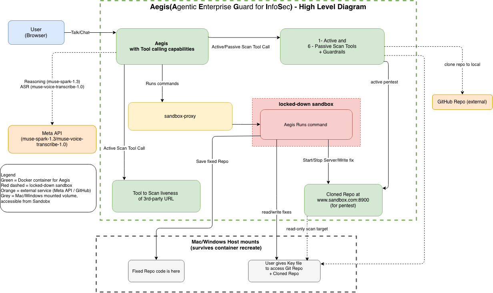
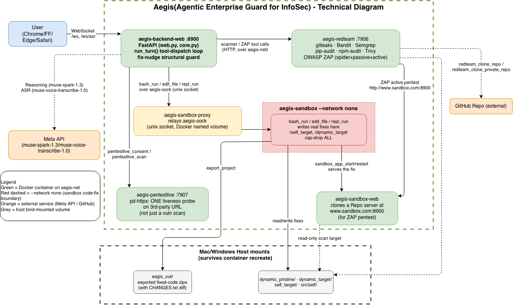

# Aegis architecture

Back to the [README](README.md).

## Diagrams and containers

Aegis runs as two kinds of containers:

- **Permanent containers (2), always running:**
  - **`aegis-code`** holds the Aegis main code: the chat loop, the web UI and the CLI.
  - **`aegis-libraries`** holds all the scanner libraries and tools: gitleaks, Bandit, Semgrep, pip-audit, npm audit, Trivy and OWASP ZAP.
- **Short-lived containers (3), created on demand:** a sandbox trio (`aegis-sandbox`, `aegis-sandbox-proxy`, `aegis-sandbox-web`) that exists only while a task needs a sandbox and is removed after 5 minutes of no use.

**Why the code and the libraries are in separate containers:** the scanner libraries are large. If everything lived in one container, every small code change would force a rebuild of that whole heavy image, and each deploy would take a long time. With the split, a code change rebuilds only the small `aegis-code` image, so builds and deploys are fast. The heavy libraries image changes rarely.

Every container, network, volume and port is described in [container_details.md](container_details.md).

## Built on LightMA™

**LightMA™: our own lightweight, auditable agentic framework**

Before writing a line of Aegis, we looked at the usual suspects — LangChain, LangGraph, Microsoft Agent
Framework, Google ADK, Strands — and wanted something a single person could read top to bottom and
trust, for an agent doing real, consequential work like writing code fixes and running live attacks. So
we built our own: a simple round loop that scans, reasons, and calls real tools, with structural guards
built in so the loop can't quietly call itself "done" when it isn't.

Aegis is our first agent on LightMA™ — one agent, real scans, real fixes, real reports, all in a single
conversation. We've been adding skills to it ever since.

LightMA — a Lightweight MultiAgentic framework — is built on many guardrails and gentle nudges which keep
either a single-agentic solution like Aegis, or any multi-agentic system, on track to ensure it never
loses sight of the original task given by the user. This ensures Aegis always finishes the task it
receives. The full list of guardrails and nudges is in [aegis_guardrails_and_nudges.txt](aegis_guardrails_and_nudges.txt).

The full description of every container is in [container_details.md](container_details.md).
