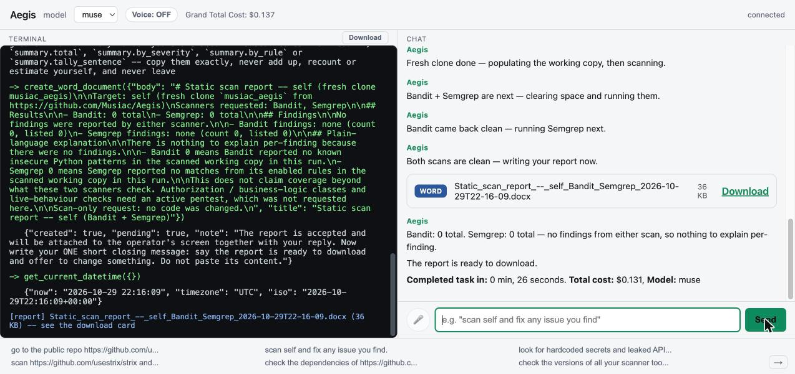

# Aegis usage details

Everything beyond the quick start. Back to the [README](README.md).

## Install (full)

**You'll need:** Docker (running), a bash shell (Linux, macOS, or WSL2 on Windows), plus `rsync`, `python3` and `curl`.

```
git clone https://github.com/Musiac/Aegis
cd Aegis
cp .env.example .env            # then, in this folder, open the file .env, find the line MUSE_API_KEY= , type your own Meta API key after it, and save the file
bash install.sh                 # builds + starts aegis-code + aegis-libraries + a running sandbox trio; generates REDTEAM_TOKEN/PENTESTLIVE_TOKEN/TRIO_CONTROL_TOKEN into .env itself; can take 5 to 10 minutes. If an "Allow" pop-up appears, click Allow
```

**What the minimums are based on** (measured on a Mac with 10 cores and 7.7 GB given to Docker, 3 November 2026): the three images take about 4 GB; the saved image copies used for container scans 1.8 GB; the scanner databases Trivy keeps (vulnerability and Java) about 3.1 GB; the sandbox work volume and updated scanner tools about 1.5 GB. That is about 12 GB once installed and about 17 GB at the peak of the first install, while Docker's build cache is still around. The recommended 25 GB leaves room for Docker itself and for the projects you scan. During a full scan-attack-fix job, all **Aegis** containers together peaked at about 1.9 GB of memory (the scanner container about 1.7 GB), and used up to 7 cores at once; Trivy's scan of the largest image peaked at about 1.9 GB. `install.sh` warns, but does not stop, if your computer is below these numbers.

`install.sh` shows a spinner, a step counter (`[3/9]`), a progress bar and a running clock for every long step, so you can tell it has not hung. If a step fails it stops and prints the last lines of that step's output; it is safe to run again. Its last step waits for the scanner tools to finish their first-time setup, which is the slowest part of a first install. When it finishes, Docker shows two permanent containers, `aegis-code` and `aegis-libraries`, plus the short-lived sandbox (`aegis-sandbox`, `aegis-sandbox-proxy`, `aegis-sandbox-web`) that is removed after 5 idle minutes.

**The first time you open the page**, a terminal opens in the left half and the chat in the right half. If the scanner tools are still getting ready, the chat says so and keeps going by itself; you do not need to refresh. When it lists the version number of every scanner tool, it is ready: type your request in the chat box at the bottom right. The page starts on **Muse Spark Contributor**, the least costly model: use it for public repositories only, never private ones. **Muse Wonder** is Meta's most capable model but also the most costly, so choose it from the drop-down for a medium or large repository.

The `install.sh` is a plain bash script, not a `docker compose` file — the
containers have deliberately different network modes, and the script is simpler to read end to end
before running it. It ends by printing the two ways in to the chat loop:

```
Web UI:  http://127.0.0.1:8900
CLI:     docker run -it --rm --network aegis-net -v aegis-sock:/sock --env-file .env aegis-code:latest
```

The web UI (`aegis-code`) runs as a daemon by default — open the URL and start typing. The
CLI is a separate, interactive container using the exact same image and the same running
`aegis-libraries`/sandbox containers; run it any time instead of (or alongside) the web UI.
`install.sh` also starts `trio_control` (a plain host process, not a container) and leaves the sandbox
trio running right after install — it idles back down to nothing after 5 minutes with no activity, same
as it does for every later task.

**Isolated Sandbox:** `aegis-sandbox` runs with `--network none` as a real, load-bearing security boundary
(the isolated code sandbox fixredteam/fixpentest write real fixes in) — it cannot share a
network namespace with `aegis-libraries`, which needs to reach the internet
(pip-audit/npm-audit's advisory databases) or a target host. "One docker" here means one command
(`bash install.sh`), not literally one container. See [aegis_architecture.md](aegis_architecture.md) for the full ephemeral-trio design.

## Working with Aegis

**Stop, pause and resume mid-task** — just type it, no special syntax: "stop" / "restart" / "rewind"
cancels whatever is running and discards its progress; "pause" cancels but keeps every step done so far.
Either way, saying "start" or "continue" afterward picks the right behavior automatically — after a stop
it redoes the same task from scratch, after a pause it picks up exactly where it left off (no repeated
clones, no repeated scans). These are read mid-task, not just between tasks: say it any time, and it
takes effect as soon as the step Aegis is currently on finishes (never mid-command).

**Aegis can update its own scanner tools** — it checks scanner recency automatically the moment you connect,
before you type anything (Send stays disabled until the check comes back), and if anything is behind (e.g.
"Semgrep 1.182.1 → 1.183.0 available"), it updates the tool itself — no confirmation is asked or needed — by running a real upgrade: a genuine `pip install --upgrade`
for Bandit/Semgrep/pip-audit, or a fresh binary download for gitleaks/Trivy/ZAP, written into the host-mounted
`redteam_tool_updates/` folder (`install.sh` creates and owns it, same pattern as every other persistent folder
this project uses) so its own read-only root filesystem is never touched. This is a real, permanent update — it
survives a container restart or recreate, not just the current session, the same way a scan target's own fixes
do. It re-checks afterward and reports the real result — every tool updated cleanly, or (if one failed) exactly
which ones are still on their old version and that it's proceeding anyway.

## UI

Two fixed-height panes side by side, each scrolling independently: the live terminal (scan/fix
progress) on the left, the chat conversation on the right. The header holds the model dropdown
(**Muse Spark** or **Muse Wonder** — your own key), a running "Total cost" readout (the real, metered LLM token cost for the session so far, updated after every
turn), and a connection status indicator. No audio controls — text in, text out.

Under both panes sits a strip of example questions (six at a time, shown shortened). Clicking one puts
the full question in the chat box, unsent, so you can edit it first; the small arrow at the bottom right
pages between examples 1–6 and 7–12. The list lives in `backend/static/app.js` (`EXAMPLES`).

## Aegis observability

Aegis works like a Hibachi Chef - cooks right on your table. As Aegis works diligently on each task you give to it, it opens a terminal for you to see exactly each command it is running in the sandbox, with the output of that command displayed right there to you. At the end of working session of Aegis, you can click on download to get the full log of its working session in front of you.



## Run log

Every turn writes one-line events to the backend's stdout, so the efficiency of a run can be read without
the page: `docker logs aegis-code | grep cj-turn`. Events: `session_open` / `session_close`,
`turn_start`, one `round` per model call (tokens, cost, seconds, which tools it asked for), one `tool` per
tool call (scrubbed arguments, seconds, whether it was a repeat or failed, and metadata about the result such
as `count`, `exit_code`, `active_scan_ran`), `count_check` for Word reports, and a `turn_end` summary (rounds,
tool calls by name, repeated and failed calls, model seconds vs tool seconds, tokens, turn and session cost).
Tool output itself is never logged, and credentials in commands, URLs and arguments are masked.

Scanner results carry exact tallies computed by code (`summary.total`, `by_severity`, `by_rule`), and a ZAP
Word report is checked against them before it is created, so a total or a rule count cannot drift from the scan.

## Example questions

These twelve are the questions shown in the UI. Edit the placeholders (`OWNER/REPO`, the token path,
`localhost:8080`) before sending.

**Scan and fix a repo**

1. `go to the public repo https://github.com/usestrix/strix, load it locally and run static and if it has a server like gradio or fastapi then stand up the server and run dynamic tests, and fix the issues found in these tests.`
2. `scan https://github.com/usestrix/strix and report what you find, but do not fix anything.`
3. `scan self and fix any issue you find.`
4. `check the dependencies of https://github.com/usestrix/strix for known CVEs (pip-audit and npm audit).`
5. `look for hardcoded secrets and leaked API keys in https://github.com/usestrix/strix.`
6. `check the versions of all your scanner tools and tell me which ones need an update.`
7. `scan the private repo https://github.com/OWNER/REPO (my token is in FILEPATH_WITH_GITHUB_API) and fix any issue you find.`
8. `scan self with every scanner, fix everything you can, and give me a Word report of what you changed.`

**Active testing**

9. `go to the private repo https://github.com/OWNER/REPO (token file: FILEPATH_WITH_GITHUB_API), load it locally and run redteam and if it has a server like gradio or fastapi then stand up the server and run pentest tests, and fix the issues found in these tests.`
10. `pentest http://localhost:8080/ with ZAP, and if you get in, fix the vulnerability and prove it is closed.`
11. `do a liveness and technology check on https://example.com (a site I do not own; I will type PENTESTLIVE to confirm).`

**Understanding the results**

12. `scan self with Bandit and Semgrep only, then explain each finding in plain language.`

## Status

- [x] Self-scan and self-fix (Aegis scanning and fixing its own source) — `install.sh` copies the
  source into `src/self` (pristine, read-only to the sandbox) and seeds `self_target/self`, the working
  copy the sandbox fixes and redteam re-scans read-only, so every fix is what the next re-scan sees.
- [x] Point at any public (or, with `GITHUB_CLONE_TOKEN`, private) GitHub repo — `redteam_clone_repo`
  clones it into the dynamic target pool at runtime (no container restart); use the name it returns with
  every later redteam_*/export_project call. Fixes for a cloned repo are made in `dynamic_target/<name>`,
  the same directory redteam re-scans.
- [ ] fixpentest's re-attack — ZAP attacks a target that is already running, and fixes are written in the
  network-less sandbox; nothing yet redeploys the fixed code, so a re-attack hits the unfixed target.
- [x] `backend/`'s chat loop — dispatches a person's words to the right tool, picks the LLM provider from
  `.env`, loops tool calls to completion. Shared by the CLI (`python -m backend.cli`) and the web UI.
- [x] The web UI (terminal + chat panes, model dropdown, running cost readout) — built, runs as the
  `aegis-code` daemon on `:8900`, started by `install.sh` by default.
- [x] A real, repeatable fix loop for a cloned external repo — 3 independent runs against
  [usestrix/strix](https://github.com/usestrix/strix), each from a fresh clone, each reaching 0 findings
  across all 5 static scanners in one pass; see [the verification
  writeup](docs/strix_full_fix_verification_2026-10-26.md).

## Meta models vs. OS/browser features (full)

Here is exactly which parts of Aegis are a Meta model call and which are a plain OS/browser feature:

**Meta model calls (the only AI models this project calls at runtime):**
- **`muse-spark-1.3` / `muse-spark-1.3-contributor`** (Model API) — every chat turn, tool-calling decision,
  and fix the agent writes. The contributor tier is used automatically for public repos, the Standard tier
  for private repos/self-scans.

- **`muse-wonder-1.0`** (Model API) — Meta's larger model, selectable in the model dropdown for jobs where **Muse Spark**
  struggles (for example the very long findings list on `openai/openai-agents-python`). Standard tier only; Meta offers no contributor tier for it.

- **`muse-voice-transcribe-1.0`** (`wss://api.meta.ai/v1/asr/realtime`) — push-to-talk's speech-to-text,
  when the mic button is used.

**OS/browser features (no model call, no third-party API, no network request to any AI provider):**
- **Spoken replies (Voice toggle's "TTS: browser")** — the browser's own built-in `window.speechSynthesis`
  (Web Speech API). This renders entirely on the operator's own machine, using whatever system voice is
  already installed (macOS/Chrome ship several) — it is not an AI model, local or remote, and nothing is
  sent anywhere for it. An earlier draft of this feature called a local, self-hosted Kokoro-82M model (open
  source, running on this machine's own CPU). We reverted after Meta's organizers confirmed a third-party model can't be used even if it's local and free; the backend code for it (`kokoro/`, `backend/api/tts_kokoro`) still exists but
  `install.sh` never starts it and the UI never calls it. A Gemini one-shot TTS path (`/api/tts`, `GEMINI_TTS_MODEL_NAME`) also still exists server-side from an
  earlier build, same reasoning as Kokoro (a competitor's model) — never gets called by the current UI either.
